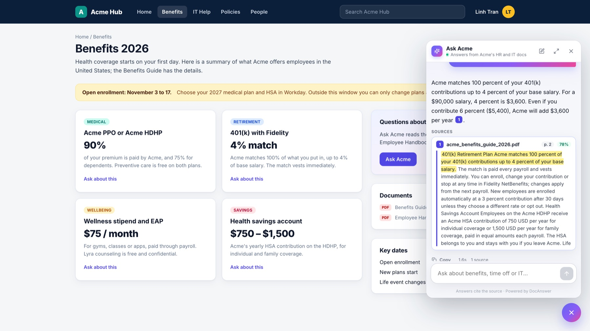

# Enterprise AI Assistant

Monorepo for an enterprise AI assistant portfolio project: a RAG chatbot that answers from your
documents and shows the passage (and PDF page) each answer comes from.



## What It Does

- Knowledge base admins upload PDF, DOCX, Markdown or text; documents are chunked, embedded with a
  free local model (`BAAI/bge-small-en-v1.5` via fastembed) and stored in Chroma. Employees
  (members) can read the document list but not change it.
- Answers stream token by token and cite sources as `[1]`, `[2]`. Clicking a citation opens the
  source passage with the quoted sentence highlighted.
- When no chunk clears the relevance threshold (`RAG_MIN_SCORE`), the assistant replies
  "I don't know" instead of guessing.
- After each answer the assistant offers next steps: up to three follow-up questions the documents
  can answer, "Talk to a person", and other channels (email, Slack, Teams; `SUPPORT_CHANNELS`).
  An "I don't know" also offers "Request this document".
- Requests land in the admin Inbox. The admin's reply is posted back into the employee's chat.
- A LangGraph router sends metric questions to a database tool and "create a ticket" requests to a
  ticket tool; a trace panel shows route, latency, retrieval scores and tool output.
- "Continue as guest" on the sign-in page creates a private guest session (`VITE_GUEST_ACCESS`).
  With `DEMO_ROLE_SWITCH=true` a "View as Employee / Admin" switch lets visitors try both sides.
  Outside the demo, `ADMIN_EMAILS` decides who registers as an admin.

## Structure

- `backend/`: FastAPI + LangGraph + Chroma RAG API
- `frontend/`: Vite + React + TypeScript UI for upload, streaming chat, citations, and tools
- `frontend/public/widget.js`: the embeddable widget; `frontend/embed.html` is the chat inside it
- `frontend/hub/`: Acme Hub, a sample company intranet that hosts the widget

## Embed the Assistant in Any Site

The assistant usually lives where employees already work: the intranet, the HR portal, the IT
portal. One script tag adds an "Ask Acme" button that opens the chat in a side panel:

```html
<script src="https://your-docanswer-host/widget.js"
        data-name="Ask Acme" data-context="benefits" defer></script>
```

- `data-context` picks the starter questions for the page (`benefits`, `it`, or none).
- `window.DocAnswer.open("How much does Acme add to my 401(k)?")` opens the panel and asks, e.g.
  from an "Ask about this" button.
- The panel keeps its conversation across page loads, shows a dot on the button when the support
  team replies, and can open the conversation in the full app.
- Only allowed sites can host it: the app's own origin plus `VITE_EMBED_ALLOWED_ORIGINS`, and
  the frontend image sends `frame-ancestors` from `EMBED_FRAME_ANCESTORS` for `embed.html`.
- Loaded by a tag manager or as a module, set `window.DocAnswerConfig = { host, name, context }`
  before the script.

Try it at http://localhost:5173/hub/ after starting the frontend: Home, Benefits and IT Help pages,
each with the widget. Employees use the widget; admins manage documents and the inbox in the
full app at http://localhost:5173.

## Run Backend

Use Python 3.11 or newer.

```bash
cd backend
uv sync --extra dev
cp .env.example .env
make seed
make dev
```

Backend URLs:

- API docs: http://localhost:8000/docs
- Health: http://localhost:8000/health

## Run Frontend

Use Node.js 20 or newer.

```bash
cd frontend
npm install
cp .env.example .env
npm run dev
```

Open http://localhost:5173.

Default frontend settings:

- API base URL: `http://localhost:8000`
- API key: `dev-secret`

## Models

Embeddings: `.env.example` uses `EMBEDDING_PROVIDER=local` (free, runs on CPU). Install it with:

```bash
cd backend
uv sync --extra dev --extra local-embeddings
```

`EMBEDDING_PROVIDER=hash` needs no download but is not semantic; use it only for tests. Each
provider gets its own Chroma collection, so re-run `make seed` after switching.

Answers: set `OPENAI_API_KEY` (and optionally `OPENAI_MODEL`, default `gpt-4.1`) for
generated answers. Any OpenAI-compatible API works through `OPENAI_BASE_URL` (OpenRouter, Groq,
Together, a local server). Without a key the app still runs in an offline extractive mode that
quotes the best-matching source sentences.

Relevance: `RAG_MIN_SCORE` overrides the "I don't know" threshold (default 0.62 for bge-small).
`SEED_ON_STARTUP=true` indexes the bundled sample docs when the index is empty, which keeps a fresh
deploy from starting with no documents.

## Sample Data

`make seed` indexes 7 internal documents for a fictional company, Acme, so the assistant works
as an employee help desk for HR and IT questions:

| Document | Format | Covers |
|---|---|---|
| `acme_employee_handbook.pdf` | PDF, 5 pages | Working hours, PTO, sick days, expenses, travel, equipment |
| `acme_benefits_guide_2026.pdf` | PDF, 3 pages | Medical, dental, 401(k) match, HSA, wellbeing, enrollment |
| `acme_it_help_desk_guide.docx` | Word | Ticket priorities, passwords and MFA, VPN, laptops, software |
| `acme_new_hire_onboarding.md` | Markdown | Before day one, first week, first 30 and 90 days |
| `acme_access_control_policy.md` | Markdown | Access requests, approvals, sensitive data, audits |
| `acme_incident_response_runbook.md` | Markdown | Severity levels, triage, communication, reviews |
| `acme_master_service_agreement.pdf` | PDF, 5 pages | Customer contract: renewal, uptime credits, data protection |

The database tool serves live-looking company metrics: revenue, customers, employees, SLA,
uptime, NPS and sales pipeline.

`backend/docs/demo_upload/acme_parental_leave_policy_2026.pdf` is deliberately not seeded. Ask
`How many weeks of parental leave do I get?` first ("I don't know"), add the PDF as an admin,
then ask again.

The PDF and DOCX files are generated from `backend/scripts/build_seed_files.py`
(`uv run --with reportlab python scripts/build_seed_files.py`).

## First Demo Flow

1. Start Postgres (`docker compose up -d db` in `backend/`), the backend and the frontend.
2. Run `make seed` in `backend/`, or switch to Admin and drop files onto the chat.
3. Sign in as an employee and ask:
   `If I earn $90,000 and put 6% in my 401(k), how much does Acme add?`
   and click the `[1]` citation (benefits guide, page 2).
4. Ask something the docs do not cover: `How many weeks of parental leave do I get?`
   ("I don't know"). Click "Request this document". As an admin, add
   `acme_parental_leave_policy_2026.pdf` and reply from the Inbox; the reply shows up in the
   employee's chat, and asking again gives a cited answer.
5. Ask: `How many employees are in engineering?` (database tool, shown as a Live data card).
6. Ask: `Create a high priority ticket: my laptop screen is cracked.` (ticket tool).

Admins are the accounts listed in `ADMIN_EMAILS`. For a quick local try, set
`DEMO_ROLE_SWITCH=true` and use the "View as" switch with a guest account.

More questions to try:

- `What is the hotel limit in London?`
- `How many PTO days carry over to next year?`
- `My VPN won't connect. What should I try?`
- `How much is the wellness stipend?`
- `What do I need to finish in my first week?`
- `What approvals are needed for production data access?`
- `What service credit do customers get if uptime drops to 98.5%?`

`uv run python scripts/run_eval.py` replays the 65 questions in `backend/evals/questions.jsonl`
against a running backend and reports route and answer-keyword accuracy.

## Docker Compose

```bash
cp backend/.env.example backend/.env
docker compose up --build
```

Then open:

- Frontend: http://localhost:5173
- Backend: http://localhost:8000/docs

## What To Build Next

- Add real login and user sessions.
- Replace fake database with Postgres.
- Add a real ticketing integration.
- Add LangSmith or OpenTelemetry tracing.
