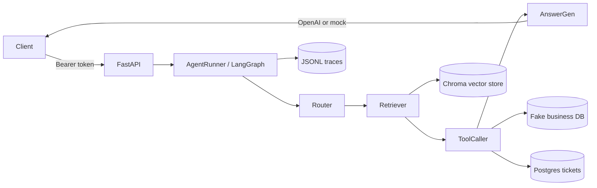

# System Design

## Architecture Overview

A FastAPI backend that answers questions over your own documents using Retrieval-Augmented
Generation (RAG), orchestrated as a small agent graph that can also call business tools (query a
demo database, create a ticket). It runs fully offline with deterministic fallbacks, or with OpenAI
when a key is configured.

## Request Flow

1. Client calls `/v1/chat` or `/v1/chat/stream`.
2. `require_api_key` validates the bearer token.
3. `AgentRunner` starts a LangGraph run with a fresh `trace_id` and `AgentState`.
4. Router classifies the request as `rag`, `database`, or `ticket`.
5. Retriever searches Chroma for relevant document chunks (runs for every route).
6. Tool caller always runs `search_docs`, plus `query_fake_database` or `create_ticket` by route.
7. Answer generator builds the final response (OpenAI with citation instructions, or a mock answer).
8. Trace metadata is appended to `logs/traces.jsonl`.

## Techniques & Patterns

- **Retrieval-Augmented Generation (RAG)** — documents are chunked, embedded, stored in a vector
  database, retrieved by similarity, and fed to the model as grounding context
  (`services/rag.py`, `services/vector_store.py`).
- **Citation-grounded answers** — the model is prompted to cite evidence as `[source#chunk_id]`,
  and citations are returned in the API response (`services/rag.py`, `agents/graph.py`).
- **Agent orchestration with LangGraph** — a `StateGraph` pipeline
  `router → retriever → tool_caller → answer_generator`, with a `TypedDict` `AgentState` passed
  between nodes (`agents/graph.py`, `agents/state.py`).
- **Intent routing** — lightweight keyword classification picks the route (`rag` / `database` /
  `ticket`) before retrieval and tool calls (`agents/graph.py`).
- **Tool calling** — discrete tools the agent can invoke: `search_docs`, `query_fake_database`,
  `create_ticket` (`agents/tools.py`).
- **Text chunking with overlap** — whitespace-normalized, fixed-size character windows with overlap
  and stable content-hash ids for idempotent indexing (`services/chunking.py`).
- **Pluggable embeddings** — provider strategy with `auto` selection: OpenAI, local fastembed, or a
  deterministic dependency-free `hash` fallback for offline use (`services/embeddings.py`).
- **Vector search** — Chroma persistent collection; idempotent upsert by chunk id and
  distance→score normalization `1 / (1 + distance)` (`services/vector_store.py`).
- **Multi-format document ingestion** — PDF (pypdf), DOCX (python-docx), and TXT/MD loaders, with
  SHA-1 content hashing for document ids (`services/document_loader.py`).
- **Streaming responses (SSE)** — `/v1/chat/stream` emits Server-Sent Events; currently simulated
  token streaming (answer split word-by-word) plus a final `done` event (`api/routes/chat.py`).
- **ORM persistence** — tickets use the SQLModel ORM (SQLAlchemy + Pydantic) over an async engine,
  with the FastAPI session-dependency pattern (`get_session` / `SessionDep`)
  (`db/models.py`, `db/database.py`, `db/tickets.py`).
- **Dependency injection + singletons** — services are wired with FastAPI `Depends` and cached with
  `lru_cache` so each is constructed once per process (`api/deps.py`).
- **Configuration via environment** — `pydantic-settings` loads typed settings from `.env`
  (`core/config.py`).
- **Token-based auth** — a shared bearer token guards all non-health routes (`api/deps.py`).
- **Observability / tracing** — every run appends a JSONL record with route, counts, and rough
  token/cost estimates (`telemetry/tracing.py`).
- **Async concurrency** — async end to end; blocking libraries (Chroma, fastembed) are offloaded
  with `asyncio.to_thread` to keep the event loop responsive.
- **Lightweight evaluation** — an eval runner checks route selection and keyword presence against a
  sample question set (`scripts/run_eval.py`, `evals/`).
- **Graceful offline degradation** — without `OPENAI_API_KEY`, embeddings fall back to `hash` and
  answers fall back to a deterministic mock, so the whole pipeline still runs.

## Tech Stack

- **API**: FastAPI, Uvicorn, Pydantic v2.
- **Agent**: LangGraph.
- **LLM / embeddings**: OpenAI (optional), fastembed (optional local), hash fallback.
- **Vector store**: ChromaDB (persistent client).
- **Relational store**: PostgreSQL via SQLModel + SQLAlchemy async (asyncpg driver).
- **Config**: pydantic-settings.
- **Tooling**: uv (packaging), ruff (lint/format), pytest (tests).
- **Ops**: Docker Compose (API + Postgres) with healthchecks, GitHub Actions CI.

## Storage

- Chroma persistent data: `data/chroma`
- Ticket Postgres database: `DATABASE_URL` (`tickets` table)
- Trace logs: `logs/traces.jsonl`

## Production Upgrades

- Replace bearer token auth with OAuth/JWT.
- Move Chroma to a managed vector database such as Pinecone, Weaviate, or Qdrant.
- Replace the fake database with real Postgres or warehouse queries.
- Add schema migrations (Alembic) instead of `create_all` bootstrap.
- Implement real token streaming from the model instead of simulated word-by-word streaming.
- Add background ingestion with Celery, Temporal, or a cloud queue.
- Add tracing with OpenTelemetry, LangSmith, or cloud-native logs.
- Add eval gates in CI before prompt or retrieval changes are merged.
